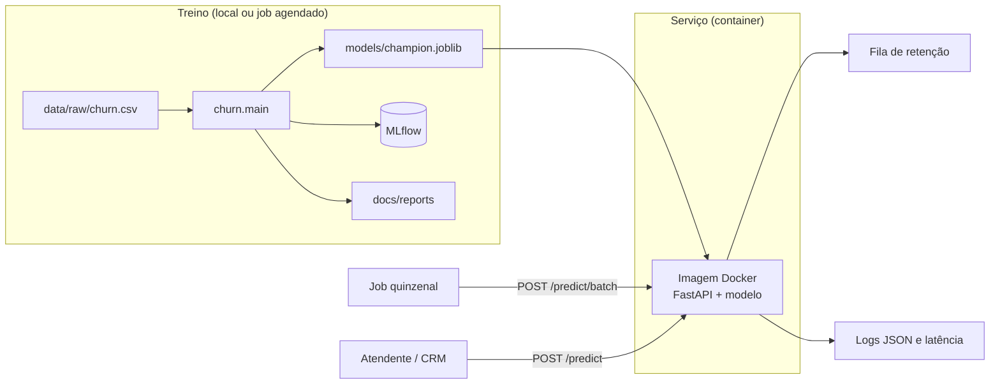

# Arquitetura de Deploy

Como o modelo de churn sai do repositório e chega ao time de retenção. O deploy em nuvem é opcional
na Fase 1 e não foi feito. Este documento descreve a arquitetura proposta, que já roda localmente com
Docker.

## 1. Decisão: lote quinzenal + API em tempo real

O ML Canvas (`docs/ml_canvas.md`) define dois usos, e a arquitetura atende os dois com o **mesmo
artefato** (`models/champion.joblib`) e a **mesma imagem Docker**:

| Uso | Quem usa | Como | Frequência |
|---|---|---|---|
| **Lote (principal)** | Time de retenção | Pontua a base ativa e gera a fila ordenada por `churn_probability` | A cada 15 dias |
| **Tempo real** | Atendente | Consulta o risco de um cliente durante o atendimento (`POST /predict`) | Sob demanda |

O lote é o uso principal, porque a decisão de negócio (quem abordar na campanha) é tomada a cada
ciclo e não exige resposta imediata. A API em tempo real complementa o atendimento individual.

## 2. Componentes



| Componente | Arquivo | Papel |
|---|---|---|
| Fluxo de treino | `src/churn/main.py` | Valida os dados, compara os modelos, treina o campeão e avalia no teste |
| Artefato | `models/champion.joblib` | Pipeline completo: feature engineering, pré-processamento, LightGBM calibrado e corte de classificação |
| API | `src/churn/api.py` | `/health`, `/predict` e `/predict/batch` (até 1.000 clientes), com validação Pydantic |
| Imagem | `Dockerfile` | Multi-stage, só dependências da API, usuário sem privilégios, healthcheck |
| Rastreamento | `mlflow.db` | Parâmetros, métricas e modelo de cada treino |
| Demonstração | `frontend/` | Dashboard com a fila de retenção (não vai para a imagem) |

## 3. Fluxo de treino

1. Extrair a base histórica com o rótulo de churn observado.
2. Rodar `make train` (`uv run python -m churn.main`): validação do schema, baseline, comparação
   por CV, campeão com tuning e calibração, avaliação única no teste.
3. Conferir no relatório (`docs/reports/test_evaluation.md`) se o campeão supera o baseline com
   intervalo de confiança acima de zero. Se não superar, o modelo atual continua em produção.
4. Rodar `make check` (lint e testes).
5. Gerar a imagem com o novo modelo (`make docker-build`) e publicá-la com uma tag de versão
   (ex.: `churn-api:2026-11-02`).

## 4. Fluxos de inferência

**Lote (quinzenal)** *(proposta: o job ainda não existe; a rota `/predict/batch` já está pronta)*:

1. Um job agendado extrai os clientes ativos com 6 meses ou mais de serviço (a API recusa os mais
   novos com 422).
2. O job envia a base em partes de até 1.000 clientes para `POST /predict/batch`.
3. As probabilidades são gravadas e a fila é ordenada da maior para a menor.
4. A equipe recebe a fila e aborda os clientes do topo até o limite da capacidade. O grupo de
   controle (10%) é sorteado antes do envio.

**Tempo real:**

1. O atendente (ou o CRM) chama `POST /predict` com os dados do cliente.
2. A API valida o payload, aplica o pipeline e devolve `churn_probability`, `churn_prediction` e o
   `threshold` usado.
3. O middleware registra a latência no log e no header `X-Process-Time-ms`.

## 5. Desempenho medido (local)

| Cenário | Resultado | Meta do canvas |
|---|---|---|
| `POST /predict`, 1 cliente | p50 de 52 ms, p95 de 94 ms | < 1 s |
| `POST /predict` no container Docker | 60 ms | < 1 s |
| `POST /predict/batch`, 1.000 clientes | 0,45 s | — |
| Base inteira (51 mil clientes, 52 chamadas) | ~25 s estimados | Antes da 3ª semana do ciclo |
| Imagem Docker | 746 MB, só CPU | Sem GPU |

## 6. Deploy em nuvem proposto

A imagem não depende de nenhum provedor. A opção mais simples é um serviço de containers gerenciado,
que escala a zero quando não há chamadas:

| Peça | GCP (recomendado) | AWS | Azure |
|---|---|---|---|
| Registro da imagem | Artifact Registry | ECR | Container Registry |
| API | Cloud Run | App Runner ou ECS Fargate | Container Apps |
| Job quinzenal | Cloud Scheduler + Cloud Run Job | EventBridge + tarefa ECS | Container Apps Job |
| Saída do lote | Cloud Storage / BigQuery | S3 / Redshift | Blob Storage |
| Logs e alertas | Cloud Logging + Monitoring | CloudWatch | Azure Monitor |

Passos no GCP:

```bash
make train && make check
docker build -t <regiao>-docker.pkg.dev/<projeto>/churn/churn-api:<versao> .
docker push <regiao>-docker.pkg.dev/<projeto>/churn/churn-api:<versao>
gcloud run deploy churn-api \
  --image <regiao>-docker.pkg.dev/<projeto>/churn/churn-api:<versao> \
  --port 8000 --memory 1Gi --cpu 1 --min-instances 0 --no-allow-unauthenticated
```

`--no-allow-unauthenticated` mantém a API privada: só serviços com permissão (o job do lote e o
CRM) podem chamá-la.

## 7. Requisitos operacionais

- **Health check:** `/health` responde `ok` com o modelo carregado e `degraded` sem ele. O Docker e o
  serviço em nuvem usam essa rota para reiniciar o container.
- **Versionamento:** cada imagem leva um único modelo. A tag da imagem identifica a versão do
  modelo, e o run do MLflow guarda os parâmetros e as métricas daquela versão.
- **Rollback:** voltar para a tag anterior da imagem. Não há estado a migrar.
- **Segurança:** API privada (sem acesso público), usuário sem privilégios no container e nenhum dado
  de cliente gravado pela API.
- **LGPD:** o payload contém dados pessoais (idade, renda, ocupação). Os logs registram só método,
  rota, status, latência, `CustomerID` e o resultado, nunca o payload.

## 8. Riscos e respostas

| Risco | Efeito | Resposta |
|---|---|---|
| `champion.joblib` ausente na imagem | API sobe em `degraded` e responde 503 | O `docker build` falha se o arquivo não existir; o health check acusa |
| Payload fora do schema | 422 com o campo e o motivo | Monitorar a taxa de 422; corrigir o sistema de origem |
| Categoria nova (ex.: região nova) | O one-hot ignora a categoria e o modelo perde informação | Monitorar categorias desconhecidas e retreinar |
| Drift ou mudança no plano de fidelidade | Queda de desempenho | Gatilhos de retreino do canvas (PSI > 0,2, AUC < 0,65) |
| Versões diferentes do scikit-learn | O modelo não carrega | Versões travadas no `uv.lock`, iguais no treino e na imagem |

Monitoramento detalhado: seção Monitoring do `docs/ml_canvas.md` e seção 8 do
`docs/model_card.md`.
